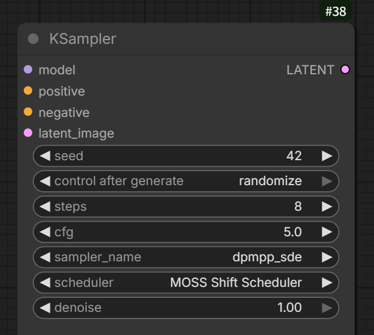

# Forge Neo MOSS Scheduler 0.9.0

[日本語はこちら](#日本語)

An unofficial Forge Neo port of [ComfyUI-MOSS-Shift-Scheduler](https://github.com/ukr8b3g-cmyk/ComfyUI-MOSS-Shift-Scheduler) v0.9.
It brings the same three sigma-schedule calculations to a compact control row in txt2img and img2img.
The main practical use case is **MOSS-Image SFT with `lora_latest.safetensors` DMD acceleration LoRA**.

> [!IMPORTANT]
> **Turn MOSS Scheduler ON to use it. Selecting Shift alone does not activate it.**
> **While ON, this extension overrides the normal Schedule Type for that generation.**
> Simple, Align Your Steps, Karras, etc. may still appear selected, but that selection is not used.
> **Turn MOSS Scheduler OFF when you want to use the normal Schedule Type.**
> This extension does not add entries to the Schedule Type list or disable the visible dropdown.


The screenshot shows **ON + Shift**. Initial state on a fresh UI is **OFF with Shift selected**.
Use the checkbox and the buttons in this lower control row, not the normal Schedule Type dropdown.

## Recommended starting settings

The recommendations follow the ComfyUI port source, with the owner's current preferred range.
They are adjustable starting points, not universal optima.

| Setting | Recommendation |
|---|---|
| Model | [MOSS-Image SFT](https://huggingface.co/OpenMOSS-Team/MOSS-Image-SFT) |
| Acceleration LoRA | [`lora_latest.safetensors`](https://huggingface.co/lodestones/MOSS-Image-SFT-8-steps-dmd/blob/main/lora_latest.safetensors) from [lodestones/MOSS-Image-SFT-8-steps-dmd](https://huggingface.co/lodestones/MOSS-Image-SFT-8-steps-dmd) |
| LoRA strength | **0.8** as a starting point; adjust to taste |
| Sampling Method | **DPM++ SDE** or **DPM++ 2M SDE** |
| Sampling Steps | **8–10** |
| CFG Scale | **3–5** |
| Model Shift | **5** |
| MOSS Scheduler | **ON** |
| Mode | **Shift** first |
| Schedule Type | Leave the current selection; it is overridden while MOSS Scheduler is ON |

**Personal starting point: 8 steps, CFG 5, model shift 5, and LoRA strength 0.8.**
The owner reports that 8 steps is faster than 10 and can give slightly more detail in their use case.
This is a personal observation, not a controlled quality or speed benchmark.
Normal SFT generation without the acceleration LoRA has had very limited practical testing.
The LoRA author recommends strength 0.7; that upstream recommendation is separate from this project's 0.8 starting point.

### ComfyUI reference settings



This supplied screenshot is from **ComfyUI**, the source of this port: **8 steps, CFG 5, `dpmpp_sde`, MOSS Shift Scheduler and denoise 1.0**.
In Forge Neo, use **DPM++ SDE** with **MOSS Scheduler ON + Shift** in the extension's control row.
Model shift and LoRA strength are not shown in the screenshot; refer to the recommendations above.

### Sampler names: two different SDE choices

| Forge Neo Sampling Method | ComfyUI sampler_name | Status |
|---|---|---|
| **DPM++ SDE** | `dpmpp_sde` | Recommended candidate |
| **DPM++ 2M SDE** | `dpmpp_2m_sde` | Recommended candidate |
| DPM++ 2M (without SDE) | `dpmpp_2m` | A different sampler; not supported by this adapter |

The two recommended choices follow the [source project's example](https://github.com/ukr8b3g-cmyk/ComfyUI-MOSS-Shift-Scheduler#日本語)
and the [original sampler comparison report](https://www.reddit.com/r/StableDiffusion/comments/1x86z9k/moss_image_samplers_and_schedulers/),
where prompt adherence was reported as good. Their Forge/ComfyUI labels differ in formatting.
DPM++ SDE and DPM++ 2M SDE are distinct algorithms; neither should be confused with plain DPM++ 2M.
ER SDE and Euler are also accepted by the implementation but are not the primary recommendations here.

## How to use

1. Install/update the extension, restart Forge Neo normally, then reload the browser.
2. Select a **MOSS-Image** model and load the intended LoRA.
3. Set **Sampling Method** to DPM++ SDE or DPM++ 2M SDE; enter steps, CFG, LoRA strength and model shift manually.
4. In the lower row shown above, enable **MOSS Scheduler** and select **Shift**, **Curve**, or **Sigma**.
5. Leave the normal **Schedule Type** selection as it is, then generate.
6. To compare against Simple, Align Your Steps or another ordinary schedule, **turn MOSS Scheduler OFF** first.

Once the row is present, changing ON/OFF or mode applies to the **next generation** without a restart.
Controls do not change your sampler, steps, CFG, LoRA, model shift, eta or stored Schedule Type.
Start comparisons with Hires. fix OFF; if enabled, the selected MOSS mode applies to the normal and HiRes passes,
using Forge's own denoise and pass settings.

| Control state | Effective schedule | Normal Schedule Type |
|---|---|---|
| OFF | The normal Forge schedule | Used as displayed |
| ON + Shift | MOSS Shift Scheduler | Overridden |
| ON + Curve | MOSS Curve Scheduler | Overridden |
| ON + Sigma | MOSS Sigma Scheduler | Overridden |

### What the three buttons mean

| Button | Source mode | Calculation difference |
|---|---|---|
| **Shift** — initially selected | MOSS Shift Scheduler | Radiance-compatible: power 2.4, midpoint_shift 0.98; steps+1 candidates and penultimate-sigma removal |
| **Curve** | MOSS Curve Scheduler | Original Power Shift defaults: power 2.0, midpoint_shift 1.0 |
| **Sigma** | MOSS Sigma Scheduler | power 2.4, midpoint_shift 0.98; timestep placement `j / (steps + 0.75)` |

See the source project's comparison tables for numerical examples.
There is no established image-quality ranking between these choices.
Hover over the checkbox or a button for help: Japanese when the **WebUI locale** is Japanese, English otherwise
(including None/unset), independently of the OS/browser language.

### Confirm the override was applied

After a successful generation, inspect the parameters/PNG Info:

```text
MOSS Scheduler: True
MOSS Scheduler Mode: MOSS Shift Scheduler
MOSS Scheduler Version: 0.9.0
```

Curve and Sigma store their corresponding full mode names.
The extension also records MOSS Schedule steps / MOSS Schedule intervals, with MOSS Hires-prefixed fields for HiRes.
These fields are written when the MOSS sigma calculation actually runs.
The ordinary Schedule type field may still show its saved value; use the **MOSS Scheduler fields** to identify the override.

PNG Info / Send to can restore the enabled state and mode.
Loading an image without MOSS fields switches this extension OFF; an unknown saved mode is also switched OFF with a notice.

## Installation

From the Forge Neo installation directory:

```bash
cd extensions
git clone https://github.com/ukr8b3g-cmyk/sd-webui-forge-neo-moss-scheduler.git
```

Restart Forge Neo and reload the browser. No extra pip installation is required.
Install one copy only. Remove/disable an earlier copy before installing a second copy.
To uninstall, stop Forge and move only this extension folder outside extensions, then restart.

## Scope, compatibility and verification

- The Forge adapter intentionally accepts **MOSS-Image models only**. Other models should be used with this extension OFF.
- The Core calculations are an unmodified port of the source project's `scheduler.py`.
  Matching model sigma tables and effective step counts give matching schedule values.
- Forge/ComfyUI can differ in denoise slicing, eta, text processing and intermediate noise.
  Matching seed/settings does not guarantee identical images.
- Normal Schedule Type, global sigma min/max/rho and Forge's extra penultimate removal do not reshape this override.
- Unsupported samplers, another active sigma override, invalid tables, or an empty denoise interval raise an error instead of silently using a different schedule.
- Checked against Forge Neo commit `0c388f8b26d26d475c2c7104aea4eafdf7bbb3e7`; a minimum older version is not established.
- CPU adapter tests cover 81 canonical mode/shift/step comparisons, restoration on failure/interruption, OFF delegation,
  conflicts, PNG normalization, denoise/HiRes slicing, and real Gradio component construction.
- Isolated Gradio 4.40.0 browser checks covered six layout conditions and eight locale conditions, preserving selection.
  The supplied screenshot shows the actual control row; no independent GPU quality/speed benchmark was performed here.

For CPU tests, use the existing Forge Python environment. From this repository, set `FORGE_NEO_ROOT` to the Forge installation root
and run `python -B tests/test_extension.py`. The canonical comparison reference is bundled as `tests/reference/comfy_scheduler.py`;
`MOSS_COMFY_SOURCE` can optionally point to another source `scheduler.py`.

## License and source

MIT. See [LICENSE](LICENSE) and [THIRD_PARTY_NOTICES.md](THIRD_PARTY_NOTICES.md).
Port source: [ComfyUI-MOSS-Shift-Scheduler v0.9](https://github.com/ukr8b3g-cmyk/ComfyUI-MOSS-Shift-Scheduler),
based on Silver's MIT Power Shift / Radiance Shift implementation.
This is an unofficial extension and is not endorsed by OpenMOSS or Forge.

---

<a id="日本語"></a>
## 日本語

### 概要・最初に確認すること

**Forge Neo MOSS Scheduler 0.9.0** は、[ComfyUI-MOSS-Shift-Scheduler](https://github.com/ukr8b3g-cmyk/ComfyUI-MOSS-Shift-Scheduler) v0.9をForge Neoへ移植した非公式拡張です。
主な使用対象は **MOSS-Image SFT＋`lora_latest.safetensors`のDMD高速化LoRA** です。

> [!IMPORTANT]
> **使うには、下部のMOSS Schedulerを必ずONにしてください。Shiftが選択されているだけでは有効になりません。**
> **ON中は、その生成で通常のSchedule Typeを使わず、下部で選んだShift／Curve／Sigmaを優先します。**
> Simple、Align Your Steps、Karrasなどが欄に表示されていても、ON中はその選択が使われません。
> **通常のスケジューラーを使いたい場合は、MOSS SchedulerをOFFにしてください。**
> この拡張はSchedule Type一覧に項目を追加したり、見た目のドロップダウンを無効化したりする方式ではありません。


画像は **ON＋Shift** の状態です。初回の状態は **OFF／Shift選択** です。
操作するのは、この下部のチェック欄とボタンです。通常のSchedule Type一覧で新しい名前を探す必要はありません。

### 推奨の開始値

移植元のComfyUI版を基にした推奨範囲です。個人の使用例であり、必須値や全環境での最適値ではありません。

| 項目 | 推奨 |
|---|---|
| モデル | [MOSS-Image SFT](https://huggingface.co/OpenMOSS-Team/MOSS-Image-SFT) |
| 高速化LoRA | [lodestones/MOSS-Image-SFT-8-steps-dmd](https://huggingface.co/lodestones/MOSS-Image-SFT-8-steps-dmd) の [`lora_latest.safetensors`](https://huggingface.co/lodestones/MOSS-Image-SFT-8-steps-dmd/blob/main/lora_latest.safetensors) |
| LoRA強度 | **0.8**を開始値に調整 |
| Sampling Method | **DPM++ SDE** または **DPM++ 2M SDE** |
| Sampling Steps | **8〜10** |
| CFG Scale | **3〜5** |
| モデルのShift | **5** |
| MOSS Scheduler | **ON** |
| 方式 | まず **Shift** |
| Schedule Type | 現在の値のまま。ON中はこちらの選択を使わない |

**個人の開始例は、8 steps・CFG 5・モデルShift 5・LoRA強度0.8です。**
作者の実使用では「10ステップより8ステップの方が速く、細部もややよかった」との所感があります。
速度や画質の比較ベンチマークではなく、同じ結果を保証するものではありません。
高速化LoRAなしの通常SFT生成は、実使用でほとんどテストしていません。
LoRA配布元の推奨強度0.7とは区別し、この拡張の開始例は0.8としています。

### 移植元ComfyUIの設定例


提供画像は移植元の **ComfyUI** の設定例です。**8 steps・CFG 5・`dpmpp_sde`・MOSS Shift Scheduler・denoise 1.0** が表示されています。
Forge Neoでは **DPM++ SDE** を選び、拡張の操作欄で **MOSS SchedulerをON＋Shift選択** にしてください。
モデルShiftとLoRA強度は画像には表示されていないため、上の推奨表を参照してください。

### サンプラー名の対応

| Forge NeoのSampling Method | ComfyUIのsampler_name | 扱い |
|---|---|---|
| **DPM++ SDE** | `dpmpp_sde` | 推奨候補 |
| **DPM++ 2M SDE** | `dpmpp_2m_sde` | 推奨候補 |
| DPM++ 2M（SDEなし） | `dpmpp_2m` | 別方式。この拡張では未対応 |

この2つは[移植元の使用例](https://github.com/ukr8b3g-cmyk/ComfyUI-MOSS-Shift-Scheduler#日本語)と、
プロンプト追従性が評価された[元の比較投稿](https://www.reddit.com/r/StableDiffusion/comments/1x86z9k/moss_image_samplers_and_schedulers/)に準拠しています。
ForgeとComfyUIでは表記が違いますが、上の表の対応です。**DPM++ SDEとDPM++ 2M SDEは別のアルゴリズム**です。
SDEのないDPM++ 2Mとも区別してください。ER SDEとEulerも実装上は対応していますが、主な推奨は上記2候補です。

### 操作手順

1. 導入・更新後はForge Neoを通常の方法で再起動し、ブラウザーを再読み込みします。
2. MOSS-ImageモデルとLoRAを選びます。
3. Sampling MethodをDPM++ SDEまたはDPM++ 2M SDEにし、Steps・CFG・LoRA強度・モデルShiftを手動で設定します。
4. 画像の下部UIでMOSS SchedulerをONにし、Shift／Curve／Sigmaを選びます。
5. 通常のSchedule TypeはそのままでGenerateを実行します。
6. 通常のSimpleやAlign Your Stepsなどと比較するときは、**MOSS SchedulerをOFF**にします。

UI表示後のON/OFFや方式の切替は、次に開始する生成へ適用されます。
サンプラー、steps、CFG、LoRA、モデルshift、eta、Schedule Typeの保存値は自動変更しません。
まずはHires. fixをOFFにして比較してください。HiResを使うときは通常・HiRes両方へ選択方式を適用し、
denoiseなどはForge側の各パスの設定を使います。

| 操作 | 実際に使う配分 | 通常のSchedule Type |
|---|---|---|
| OFF | Forge標準で選んだもの | 表示どおり使う |
| ON＋Shift | MOSS Shift Scheduler | 上書きされ、この選択は使わない |
| ON＋Curve | MOSS Curve Scheduler | 上書きされ、この選択は使わない |
| ON＋Sigma | MOSS Sigma Scheduler | 上書きされ、この選択は使わない |

### 3つのボタンとヘルプ

| ボタン | ComfyUI版での方式 | 計算上の違い |
|---|---|---|
| **Shift**（初期選択） | MOSS Shift Scheduler | 元のRadiance互換。power 2.4、midpoint_shift 0.98。steps+1候補とゼロ直前の点の削除 |
| **Curve** | MOSS Curve Scheduler | 元のPower Shift既定曲線。power 2.0、midpoint_shift 1.0 |
| **Sigma** | MOSS Sigma Scheduler | power 2.4、midpoint_shift 0.98。時刻を `j / (steps + 0.75)` に配置 |

数値例は移植元READMEの比較表を参照してください。方式ごとの画質順位は確定していません。
チェック欄とボタンにマウスを乗せると説明が表示されます。
**WebUIロケールが日本語なら日本語、それ以外（None／未設定を含む）は英語**です。OSやブラウザーの言語には連動しません。

### 実際に適用されたか確認する

生成後のパラメーター／PNG Infoで、次の項目を確認します。

```text
MOSS Scheduler: True
MOSS Scheduler Mode: MOSS Shift Scheduler
MOSS Scheduler Version: 0.9.0
```

Curve／SigmaではModeが対応するフルネームになります。
MOSS Schedule steps／MOSS Schedule intervals、HiResではMOSS Hiresで始まる段数情報も記録します。
これらは実際にMOSSのsigma計算が走ったときに付く情報です。
通常のSchedule type欄には元の保存値が残ることがあります。**適用確認はMOSS Schedulerの項目で行ってください。**

PNG Info／Send toで有効状態と方式を転送できます。
MOSS情報のない画像を読み込むとOFFに戻り、未知の保存モードも通知してOFFにします。

### 導入・取り外し

Forge Neoフォルダーでターミナルを開いて実行します。

```bash
cd extensions
git clone https://github.com/ukr8b3g-cmyk/sd-webui-forge-neo-moss-scheduler.git
```

Forge Neoを再起動し、ブラウザーを再読み込みます。追加pipインストールは不要です。
導入は1コピーだけにしてください。旧コピーがある場合は無効化してから導入します。
取り外すときはForge停止後、この拡張フォルダーだけをextensions外へ退避し、再起動します。

### 対応範囲・検証

- Forge側のアダプターは **MOSS-Image専用**です。他モデルではOFFにしてください。
- 計算処理はComfyUI版のscheduler.pyを改変せず移植しています。同じモデルsigmaテーブル・実効stepsなら値が一致します。
- denoiseの切り出し、eta、テキスト処理、途中ノイズなどはForgeとComfyUIで異なり得ます。同じseedでも同一画像は保証しません。
- ON中は通常のSchedule Type、汎用sigma min/max/rho、Forgeの追加penultimate削除で配分を再加工しません。
- 未対応サンプラー、他のsigma overrideとの競合、不正なテーブル、denoise後の区間不足はエラーで停止します。
- Forge Neoの確認対象はコミット `0c388f8b26d26d475c2c7104aea4eafdf7bbb3e7`です。最低対応の旧版は確定していません。
- CPUテストで81条件の正本比較、OFF時の委譲、例外・中断後の復元、競合、PNG値、denoise／HiRes切り出し、Gradio部品構築を確認しています。
- 隔離Gradio 4.40.0のブラウザー確認では、配置6条件とロケール8条件で選択維持まで確認しています。
  提供画像で実画面のUI表示も確認できていますが、こちらで独立したGPU画質・速度ベンチマークは行っていません。

CPUテストは既存のForge Python環境で実行します。このリポジトリを作業ディレクトリにして、
`FORGE_NEO_ROOT`にForgeのルートを指定し、`python -B tests/test_extension.py`を実行してください。
比較用の正本は`tests/reference/comfy_scheduler.py`に同梱し、任意で`MOSS_COMFY_SOURCE`に別のscheduler.pyを指定できます。

### ライセンス・移植元

MIT。[LICENSE](LICENSE)と[THIRD_PARTY_NOTICES.md](THIRD_PARTY_NOTICES.md)を参照してください。
移植元は[ComfyUI-MOSS-Shift-Scheduler v0.9](https://github.com/ukr8b3g-cmyk/ComfyUI-MOSS-Shift-Scheduler)です。
Silver氏のMIT版Power Shift／Radiance Shiftの計算と著作権表示を継承しています。
OpenMOSSおよびForge公式の製品ではありません。
